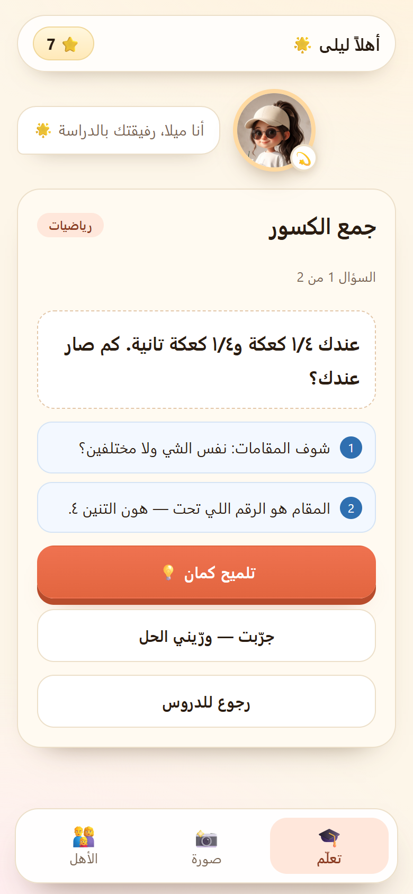
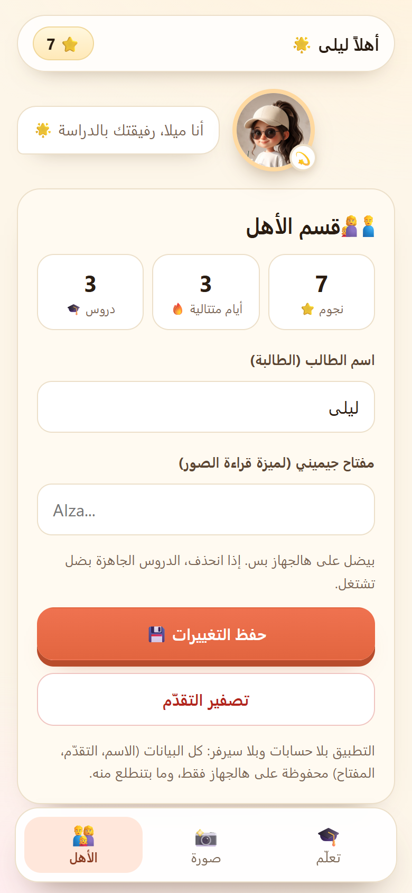
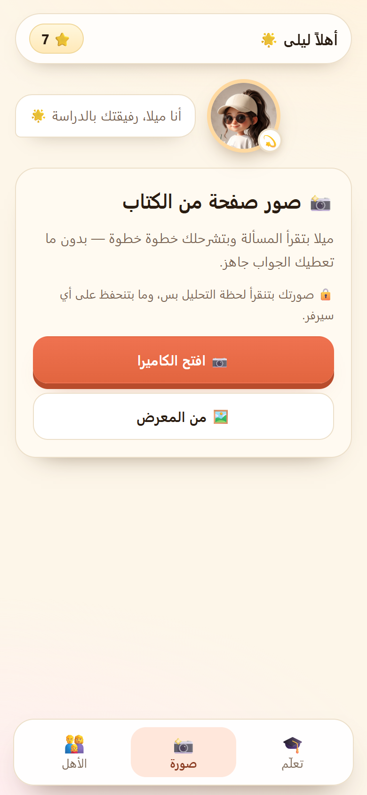

# ميلا — رفيقة الدراسة 🌟

تطبيق عربي (RTL) لطالب واحد على جهازه: دفتر دراسة، دروس سقراطية بتلميحات متدرّجة، وقراءة صور صفحات الكتب.
**بلا حسابات، بلا سيرفر، وبلا قاعدة بيانات**: كل البيانات — الاسم، التقدّم، ومفتاح جيميني — بتنحفظ على الجهاز فقط.


## الفكرة

- **ولي الأمر بيحضّر التطبيق مرة واحدة**: رقم سري، اسم الطالب/الطالبة، الصف، والجنس (طالب/طالبة)، ومفتاح جيميني المجاني (اختياري).
- الطالب بيفتح على دفتره، وقسم الأهل محمي بالرقم السري.
- قراءة الصور بتنطلق **من الجهاز مباشرة** لمفتاح ولي الأمر، فما في مفتاح مشترك بين الناس ولا صور بتوصل لسيرفر تبعنا.
- الدروس الجاهزة والتلميحات بتشتغل **بلا إنترنت وبلا مفتاح**.
- الخطاب داخل التطبيق محايد (بيخاطب الطالب بصيغة عامة، ما بيفترض إنه بنت).

## الشاشات

| التحضير | الدرس | الأهل |
| --- | --- | --- |
|  |  |  |

صفحة الصورة: 

## التشغيل

```bash
npm install
npm run dev      # http://localhost:5173
npm run build    # يبني dist/ (typecheck + vite)
```

## تحميل الـ APK (بدون Android Studio)

كل مرة بينعمل push على `main`، GitHub Actions بتبني الملف وبتحطّه جاهز للتنزيل:

1. افتح تبويب **Actions** بالريبو → آخر تشغيل لـ `CI`.
2. انزل لآخر الصفحة عند **Artifacts** → نزّل **`mila-apk`**.
3. بيفكّ الضغط بيطلع ملف `mila.apk`.
4. على الأندرويد: **فتح الملف → تثبيت** (لازم تسمح بـ«تثبيت من مصادر غير معروفة» للتطبيق اللي بتفتح منه الملف).

> الـAPK موقّع بمفتاح debug (مناسب للتجربة والاستخدام العائلي، مش للنشر على Google Play).
> اسم التطبيق على الجهاز: **ميلا**، ومعرّف الحزمة: `com.studybuddy.mila`.

## البنية

```
src/
  App.tsx                # الحالة العامة: تحضير، تعلّم، صورة، الأهل
  components/
    Wizard.tsx           # أول تشغيل (ولي الأمر)
    Lock.tsx             # بوابة الرقم السري
    LessonView.tsx       # درس سقراطي بتلميحات
    PhotoView.tsx        # رفع صورة + تحليل
    ParentView.tsx       # إعدادات وتقدّم
    Mila.tsx             # أفاتار ميلا وحالاتها
  lib/
    store.ts             # تخزين محلي (settings/progress)
    lessons.ts           # دروس جاهزة بلا إنترنت
    ai.ts                # نداء Gemini المباشر (مفتاح ولي الأمر)
  assets/mila-face.jpg   # أفاتار ميلا (مقصوص من صورة الموقع الأول)
android/                 # مشروع Capacitor الأصلي (مولّد، متعقّب بالريبو)
resources/               # أيقونة التطبيق وشاشة البداية (المصدر)
capacitor.config.ts
```

## الخصوصية

- ما في طلبات لسيرفر تبعنا: لا تسجيل، لا تتبّع.
- الصورة بتنرسل لجوجل (Gemini) **لحظة التحليل بس**، وبعدها ما بتنحفظ.
- حذف بيانات التطبيق من إعدادات الجهاز = حذف كل شي.

## خطة الطريق

- [x] بناء APK عبر GitHub Actions (Capacitor) كـartifact.
- [ ] توقيع release بمفتاح خاص (للنشر على Play).
- [ ] صوت ميلا (TTS) مع تفضيل لهجة سورية.
- [ ] دروس أكثر لكل الصفوف.

## الترخيص

MIT.
