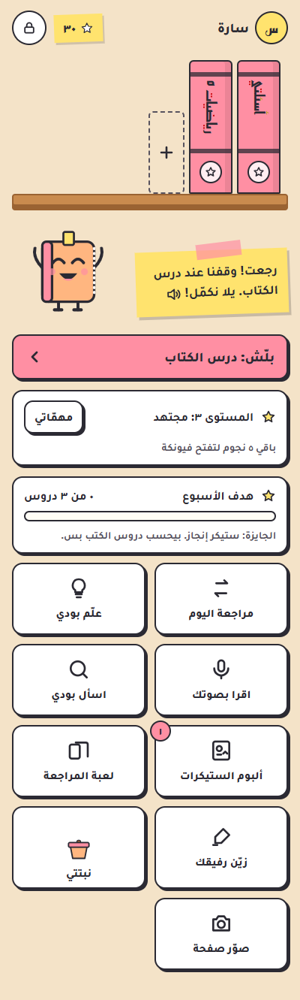
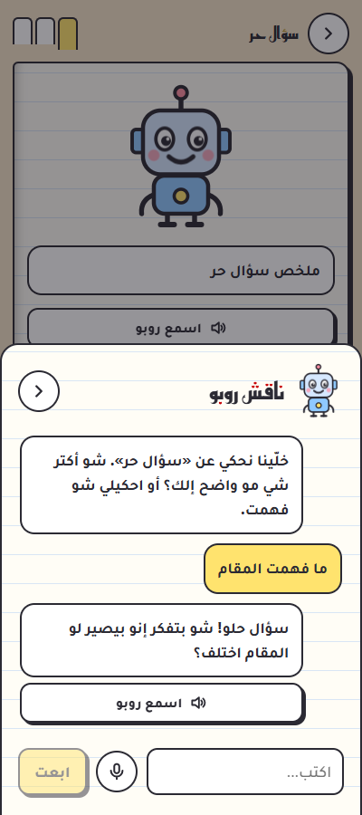
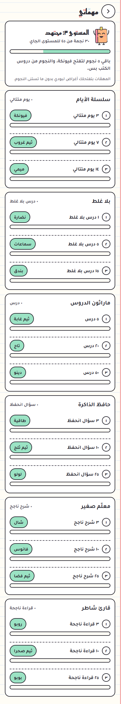

# StudyBuddy: رفيقك بالدراسة 📒

> **StudyBuddy** is a free, offline-first Arabic study companion for kids (Android): a sticker notebook, companion characters, real books built from photos of school pages, a parent area, and optional parent-to-student sync over Firebase. Download the APK from [Releases](../../releases/latest).

تطبيق أندرويد عربي (RTL) لدراسة الأولاد. كل طالب إلو **رفيق** بيختاره، وكتب حقيقية بتنحط عالرف، ودروس بتنعمل من صور صفحات كتابو المدرسي بمساعدة جيميني. بلا إعلانات وبلا تتبّع، والبيانات على الجهاز.

<p align="center">
  
  
  
  
</p>

## شو فيه

- **رفقاء بيتفتحوا بالنجوم**: بودي وياسمينة من البداية، وبعدين سلحفوش وروبو وفانوس وميمي (قطة) ولولو (أرنب) وبندق (باندا) ودينو وبوبو (بومة). كل واحد إلو شكل وطبع وصوت. وإضافات (نضارة، طاقية، شال، فيونكة، سماعات، تاج) وثيمات (دفتر، بحر، غابة، حلويات، صحرا، غروب، ثلج، فضا).
- **مكتب وكتب حقيقية**: رف كتب، غلاف بينفتح، وفهرس بالدروس.
- **الدرس صفحة بصفحة**: شرح قصير، "اشرح غير شكل"، أسئلة خيارات، و"مين الغلطان؟". الغلط مو عقوبة: الخيار بينشطب وبيجي تلميح.
- **ناقش رفيقك بالدرس**: محادثة مباشرة، كتابة أو رسالة صوتية. الرفيق بيسأل وبيلمّح وما بيعطي الجواب جاهز.
- **مراجعة اليوم**: الأسئلة اللي غلط فيها الطالب بترجع بعد يوم وتلاتة وسبعة وأربعتعش يوم، لحد ما تنحفظ.
- **علّم رفيقك**: الرفيق بيتظاهر إنو ما فهم والطالب بيشرحلو. و**اقرا بصوتك**: الرفيق بيسمع القراءة وبيصحّح النطق بلطف.
- **نجوم صعبة وبتتعب عليها**: بس من دروس الكتب، بشرط دقيقة على الأقل، وسقف يومي، وكل صفحة مرة وحدة. ومعها **مهمّات بمراحل** و**مستويات** وهدف أسبوعي.
- **قسم الأهل بقفل رمز** (٤ لـ ٦ أرقام، مشفّر، بيقفل ٥ دقايق بعد ٥ محاولات غلط): ملخص اليوم، تقدم الأسبوع، الذاكرة (وين بيقوى ونوع الغلط المتكرر)، تقرير بصوت الرفيق، حد دراسة يومي، واجب مصوّر، وإدارة الكتب (إضافة، أرشفة، حذف) مع زر يسمح للطالب.
- **جهاز للأهل (اختياري)**: ربط عبر Firebase المجاني. الأهل بيتابعوا الطالب ويضيفوله كتب ووقت وواجبات من تلفونهم. دليل الإعداد بـ`firebase/SETUP-FIREBASE.md`.
- **نسخة احتياطية ZIP** لكل بيانات الطالب (بالإيد)، وبترجّعها على أي جهاز.
- **تحديث من التطبيق**: بانر "في نسخة جديدة" عند الطالب والأهل، والتحديث بيتثبّت فوق النسخة الحالية وبياناتك بتضل.

## التثبيت والتحديث

1. من صفحة [Releases](../../releases/latest) نزّل ملف `studybuddy-vX.Y.Z.apk` وثبّتو على التلفون (بيطلب تسمح بالتثبيت من هالمتصفح).
2. أول ما تفتحو: اختار دورك (طالب أو أهل)، حط رمز الأهل، وحط مفتاح جيميني المجاني من [Google AI Studio](https://aistudio.google.com/apikey) من قسم الأهل.
3. التحديثات الجاية بتطلع كبانر داخل التطبيق. بتضغط "نزّل التحديث" وبتثبّتو فوق النسخة الموجودة. **البيانات بتضل لأنو التوقيع ثابت.** للأمان صدّر نسخة ZIP قبل.

### إذا كان عندك StudyBuddy القديم (50.x)

النسخة الجديدة بمعرّف تطبيق جديد (`com.studybuddy.family`)، فبتتثبّت **جنب القديمة** وما بتمسح شي:

1. بالتطبيق القديم: قسم الأهل ← نسخة احتياطية ← صدّر. بتطلع ملف `.json`.
2. بالتطبيق الجديد: قسم الأهل ← نسخة احتياطية ← "استيراد نسخة" واختار هالملف. بتنتقل بيانات الطالب (دروس، كتب، صور صفحات، نجوم، ذاكرة).
3. لما تتأكد إنو كل شي موجود، امسح القديم.

## للمطوّر

```bash
npm ci --include=dev
npm run dev        # http://localhost:5173
npm test           # اختبارات المنطق (Node)
npm run build      # typecheck + vite build
```

- كل push على `main` بيشغّل GitHub Actions: فحص الأنواع، الاختبارات، البناء، وAPK موقّع، وبينشر Release باسم `v<version>` من `package.json`.
- التوقيع بمفتاح ثابت من أسرار المستودع (`ANDROID_KEYSTORE_B64` وأخواتها). **ما بينحط مفتاح بالكود أبداً.** لو ضاع المفتاح ما بتنحدّث التطبيقات المثبتة.
- نزّل نسخة جديدة: ارفع `version` بـ`package.json`، وضيف `docs/release-notes/v<version>.md`، وادفع. رقم `versionCode` بيتحسب لحالو من الرقم.
- على ويندوز لا تبني من مجلد Google Drive: Gradle بيفشل لأنو Drive بيقفل الملفات.

```
src/
  App.tsx            # الحالة والتنقل
  lib/               # store، ai (جيميني)، companions، rewards، security (الرمز)، sync (Firebase)، notify، backup، update
  components/        # Setup، Who، Desk، BookView، LessonPlayer، LessonChat، Album، Game، Review، Teach، ReadAloud، Missions، Parent، Sheets
firebase/            # قواعد Firestore ودليل الإعداد
tests/               # اختبارات المنطق
```

## المساهمين

Tarek Nahas، AI
