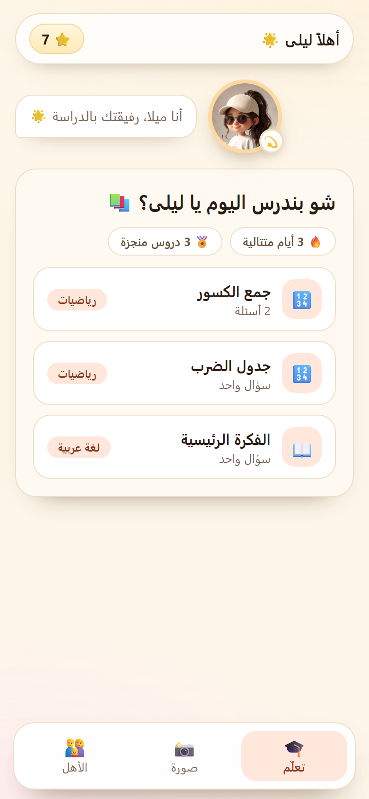

<h1 align="center">StudyBuddy · ليلي</h1>

<p align="center">
  <b>Arabic study companion for kids: a local notebook, step-by-step lessons, and photo reading</b><br>
  <b>رفيق دراسة عربي للأطفال: دفتر محلي، دروس خطوة بخطوة، وقراءة صور الكتب</b>
</p>

<div dir="rtl">

> **ليش اسمها ليلي؟** ليلي وروي هما الشخصيتين اللي بيحكو مع الطفل: ليلي للبنت، وروي للولد. الفكرة إنو الطفل يحس إنو عندو رفيق قريب، بيشرح بصبر وبلهجتو، وبيسأل وبيتعلّم بإيدو.

</div>

> **Why Layla?** Layla and Roy are the two companions that talk to the child: Layla for a girl, Roy for a boy. The idea is that the child feels they have a patient friend who explains in their own dialect and helps them learn by doing.

<p align="center">
  <a href="#english">English</a> &nbsp;·&nbsp; <a href="#بالعربي">بالعربي</a> &nbsp;·&nbsp; 📘 <a href="https://github.com/tareknahas85-star/studybuddy/releases/download/guide-v1.0.0/Studybuddy-Guide.html">Interactive guide · الدليل التفاعلي</a>
</p>

<p align="center">
  
</p>

## Download · التحميل

| | 📘 Guide · الدليل | Android · أندرويد |
|---|---|---|
| **Latest · آخر نسخة** | [⬇️ Interactive guide · الدليل التفاعلي](https://github.com/tareknahas85-star/studybuddy/releases/download/guide-v1.0.0/Studybuddy-Guide.html) | [⬇️ APK v50.5.0](https://github.com/tareknahas85-star/studybuddy/releases/download/v50.5.0/studybuddy-v50.5.0.apk) |

📘 **Start here:** the interactive guide is one HTML file that works offline on any device. Download it and open it in any browser. It is in English first, then Arabic.
📘 **ابدأ من هون:** الدليل التفاعلي ملف واحد بيشتغل بلا نت على أي جهاز. نزّلو وافتحو بأي متصفح. أول إنكليزي، وبعدين عربي.

All releases are on the [releases page](https://github.com/tareknahas85-star/studybuddy/releases/latest).
كل الإصدارات بـ[صفحة الإصدارات](https://github.com/tareknahas85-star/studybuddy/releases/latest).

---

<a id="english"></a>

## English

A bilingual (Arabic-first interface, right to left) study app for one child on one device. The child asks a question, or photographs a book page, and Layla explains the lesson step by step with hints and multiple-choice checks. There are no accounts and no server: the name, books, lessons, photos, memory and the Gemini key all stay on the device.

### Status

It works, but it is a personal project. The Android APK is a debug build, signed with the debug key. It is good for trying it out and for family use, but it is not published on Google Play. The app is also available in a browser.

### What it does

- Answers questions in Arabic with a step-by-step explanation, hints and multiple-choice questions, using Gemini.
- Reads photos of book pages, notebooks or boards, and sorts them into lessons (one or more per photo).
- Explains each lesson three ways: **written**, **voice** (a natural Shami voice from Gemini TTS, saved on the device so it plays offline after the first time), and **video** (a YouTube search).
- Keeps a local **archive** (My lessons) with every lesson and its photo, so the child can reopen them any time.
- Has **My books**: add a book and see its latest lessons in one place.
- Builds a **child memory** in the parents' area: level per subject, how the child learns best, interests, and the parents' notes. It grows from actions inside the app.
- Lets the parent pick the voice, and protects the parents' area with a PIN.

### How it is organized

| Tab | What is in it |
|---|---|
| **Ask · اسأل** 🔎 | The Gemini search, Add a book, My books and the latest lessons |
| **My lessons · دروسي** 🗂️ | The archive of saved lessons and photos, with delete |
| **Parents · الأهل** 👨‍👩‍👧 | Overview and child memory (protected by the parent PIN) |

### Getting started (parent setup)

1. Install the APK, or open the app in a browser.
2. The setup wizard asks for a **secret PIN**, the **student's name, grade and gender** (boy or girl), and a **free Gemini key** from [Google AI Studio](https://aistudio.google.com/app/apikey).
3. Start with a question, or photograph a book page.

Without a Gemini key, search and photo analysis do not work, but the archive and saved lessons still do.

### Privacy

- No accounts, no tracking, and no server of ours.
- Photos are compressed on the device. They are sent to Google (Gemini) **only at the moment of analysis**, and then saved locally in IndexedDB so the child can reopen them.
- No microphone or background monitoring. The child memory is built from actions inside the app only.
- Deleting the app data from the device settings deletes everything, including the archive.

### Build it yourself

```bash
npm install
npm run dev      # http://localhost:5173
npm run build    # builds dist/ (typecheck + vite)
```

The Android project is generated by Capacitor (see `android/`). The APK is also built by GitHub Actions on every push to `main`.

### Your data

Everything stays on the device: the name, books, lessons, photos, memory and the Gemini key. The only outside traffic is to Google's Gemini API, and only when the child asks a question or a photo is analysed.

### Built with

React, TypeScript, Vite, Capacitor, and the Gemini API (text, vision and TTS).

### Roadmap

- [x] APK built through GitHub Actions (Capacitor).
- [x] Gemini search, books, photo analysis and local archive.
- [x] Natural Shami voice (Gemini TTS), video and multiple-choice questions.
- [x] Child memory and the parents' report.
- [ ] Export and import of the archive and memory, to move between devices.
- [ ] Tests (unit and end-to-end).
- [ ] Signed release build for Google Play.

### License

MIT.

### Contributors

- Tarek Nahas - design and idea, author and maintainer
- AI - implementation

---

<a id="بالعربي"></a>

<div dir="rtl">

## بالعربي

تطبيق دراسة عربي (واجهة من اليمين لليسار) لطفل واحد على جهاز واحد. الطفل بيسأل سؤال، أو بيصوّر صفحة كتاب، وليلي بتشرح الدرس خطوة بخطوة مع تلميحات وأسئلة اختيار من متعدد. ما في حسابات ولا سيرفر: الاسم والكتب والدروس والصور والذاكرة ومفتاح Gemini كلها بتضل عالجهاز.

### الحالة

شغّال، بس هو مشروع شخصي. ملف الأندرويد نسخة debug موقّعة بمفتاح debug. منيح للتجربة والاستعمال العائلي، بس مو منشور عـGoogle Play. وفيه نسخة بالمتصفح كمان.

### شو بيعمل

- بيجاوب الأسئلة بالعربي، بشرح خطوة بخطوة وتلميحات وأسئلة اختيار، بالاعتماد على Gemini.
- بيقرا صور صفحات الكتب والدفاتر والسبورة، وبيرتّبها بدروس (درس أو أكتر بالصورة الواحدة).
- بيشرح كل درس بثلاث طرق: **كتابة**، و**صوت** (بصوت شامي طبيعي من Gemini TTS، بينحفظ عالجهاز فبيشتغل بلا نت بعد أول مرة)، و**فيديو** (بحث يوتيوب).
- فيه **أرشيف محلي** (دروسي) بكل درس وصورته، ويرجع له الطفل وقت ما بدّو.
- فيه **كتبي**: أضيف كتاب وشوف آخر دروسو بمكان واحد.
- بيبني **ذاكرة الطفل** بقسم الأهل: مستوى كل مادة، طريقة التعلّم الأحسن، الاهتمامات، وملاحظات الأهل. بتكبر مع الأفعال داخل التطبيق.
- ولي الأمر بيختار الصوت، وقسم الأهل محمي برقم سري.

### كيف مرتّب

| التبويب | شو فيه |
|---|---|
| **اسأل** 🔎 | بحث Gemini، إضافة كتاب، كتبي، وآخر الدروس |
| **دروسي** 🗂️ | الأرشيف: الدروس والصور المحفوظة، مع حذف |
| **الأهل** 👨‍👩‍👧 | نظرة عامة وذاكرة الطفل (محمي برقم ولي الأمر) |

### البداية (تحضير ولي الأمر)

1. نزّل ملف الـAPK، أو افتح التطبيق بالمتصفح.
2. معالج التحضير بيطلب **رقم سري**، و**اسم الطالب والصف والجنس** (طالب أو طالبة)، و**مفتاح Gemini مجاني** من [Google AI Studio](https://aistudio.google.com/app/apikey).
3. ابدأ بسؤال، أو صوّر صفحة كتاب.

بدون مفتاح Gemini، البحث وتحليل الصور ما بيشتغلوا، بس الأرشيف والدروس المحفوظة بيضلوا شغّالين.

### الخصوصية

- ما في حسابات، ولا تتبّع، ولا سيرفر تبعنا.
- الصور بتنضغط عالجهاز، وبتنرسل لجوجل (Gemini) **لحظة التحليل بس**، وبعدين بتنحفظ محلياً بـIndexedDB حتى يرجع لها الطفل.
- ما في ميكروفون ولا مراقبة بالخلفية. ذاكرة الطفل بتتبنى من أفعال داخل التطبيق بس.
- حذف بيانات التطبيق من إعدادات الجهاز بيحذف كل شي، بما فيه الأرشيف.

### بناء المشروع بإيدك

```bash
npm install
npm run dev      # http://localhost:5173
npm run build    # بيبني dist/ (فحص الأنواع + vite)
```

مشروع الأندرويد مولّد بـCapacitor (بمجلد `android/`). وملف الـAPK بيتبنى تلقائياً عـGitHub Actions كل ما ينعمل push على `main`.

### بياناتك

كل شي بيضل عالجهاز: الاسم والكتب والدروس والصور والذاكرة ومفتاح Gemini. الشي الوحيد اللي بيطلع برا هو لـGemini API، ولما الطفل يسأل سؤال أو تنحلل صورة.

### شو بنبني بعدين

- [x] ملف APK عبر GitHub Actions (Capacitor).
- [x] بحث Gemini، والكتب، وتحليل الصور، والأرشيف المحلي.
- [x] صوت شامي طبيعي (Gemini TTS)، وفيديو، وأسئلة اختيار.
- [x] ذاكرة الطفل وتقرير ولي الأمر.
- [ ] تصدير واستيراد الأرشيف والذاكرة للنقل بين الأجهزة.
- [ ] اختبارات (unit و e2e).
- [ ] نسخة موقّعة للنشر على Google Play.

### الترخيص

MIT.

### المساهمون

- Tarek Nahas: التصميم والفكرة، وصاحب المشروع والمشرف عليه
- AI: التنفيذ

</div>

## Contribute · ساهم معنا

Bug reports, ideas and wording fixes are very welcome. Open an issue, and use [Discussions](../../discussions) for questions.

بلاغات الأخطاء والأفكار وتصحيحات الصياغة مرحّب فيها. افتح issue، والأسئلة احكيها بـ[Discussions](../../discussions).
